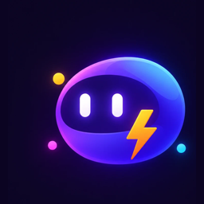

<div align="center">



# Shellhouse

**A little office of AI agents that live on your Mac.**

Each bot has its own name, personality, model, memory and persistent Linux computer.
They remember, schedule their own work, and coordinate with each other, all on hardware you control.


     

</div>

---

## What it is

Shellhouse is a native SwiftUI Mac app for running a *roster* of independent AI agents, not a single chatbot. Every bot is a real agent with its own sandboxed Linux desktop, so it can use a shell, a browser, files and the GUI to get work done, then report back.

- **A computer per bot.** Each bot drives its own persistent Debian desktop over SSH: screenshots, clicks, typing, shell and files.
- **Memory that lasts.** Bots keep durable facts and open tasks across conversations, and recall them when they're relevant.
- **Work while you're away.** Bots schedule their own routines ("check this daily", "post a standup every morning") from the menu bar.
- **Teams, not threads.** Bots message each other, delegate, recruit a new specialist, and share group chats with goals and checklists.
- **Guardrails by default.** Shell commands and bot creation ask for approval. Untrusted content can't silently escalate, and every decision is audited.
- **Local-first models.** Models run through Ollama on your Mac. A bot can use any OpenAI-compatible endpoint if you choose.

The full tour of the app is in **[macos/README.md](macos/README.md)**.

## How it fits together

```
 ┌──────────────── Your Mac ─────────────────┐            ┌──────────── Linux host (~/shellhouse) ────────────┐
 │                                           │            │                                                 │
 │  Shellhouse.app                           │    SSH     │  sandbox-manager   the only privileged service; │
 │   ├─ bots, groups, memory, routines       │  tunnel    │   (unix socket)    creates and drives sandboxes │
 │   ├─ guardrails + approvals + audit log  ─┼───────────▶│        │                                        │
 │   └─ Ollama (local models, Metal)         │            │        ▼                                        │
 │                                           │            │  one Debian desktop per bot: a container, or    │
 └───────────────────────────────────────────┘            │  with KVM a Firecracker microVM (own kernel)    │
                                                          └─────────────────────────────────────────────────┘
          optional:  group-relay (share groups with friends) · egress-proxy (per-sandbox outbound allowlist)
                     · Firecracker microVMs instead of containers (--with-firecracker, needs KVM on the box)
```

The repo also contains the **Docker/Python reference stack** the app grew out of: a single-agent loop with a web UI (`api/`, `web/`), durable task queue, vector memory, MCP client and deterministic evals. It runs entirely in Docker and is still the design reference for features the Mac app hasn't adopted. The installer doesn't set it up (see [Running the Docker stack by hand](#running-the-docker-stack-by-hand)).

## Repository layout

| Path | What lives there |
|---|---|
| [`macos/`](macos/) | The Shellhouse Mac app: SwiftUI app, `AgentCore` (agent loop, tools, guardrails, model backends), tests |
| [`skills/`](skills/) | Playbooks bundled into the app; a bot loads one only when a task calls for it |
| [`avatars/`](avatars/) | The 64 animated bot avatars (8 shapes × 8 colors) |
| [`sandbox/`](sandbox/) | The Debian desktop image every bot runs in, the in-sandbox agent runner, and the Firecracker microVM scripts and guest image |
| [`sandbox-manager/`](sandbox-manager/) | The privileged service that creates, runs and tears down sandboxes: a container by default, a host systemd service with Firecracker |
| [`egress-proxy/`](egress-proxy/) | Optional outbound-traffic allowlist for sandboxes (compose profile `egress`) |
| [`group-relay/`](group-relay/) | Optional server for sharing group chats with friends (compose profile `relay`) |
| [`api/`](api/), [`web/`](web/), [`evals/`](evals/) | The Docker/Python reference stack and its evaluation suites |
| [`docs/`](docs/) | Security model, guardrails, reliability, egress, Firecracker and design notes |
| [`scripts/`](scripts/) | Host helpers used by `initial_setup.sh` and `uninstall.sh`, and the sshd drop-in for the model proxy |
| `Install Shellhouse.command`, `initial_setup.sh`, `build.sh`, `uninstall.sh` | Set up the Linux box, build and install the app, and remove it all again |

## Install

### What you need

| | Requirement |
|---|---|
| **Your Mac** | Apple Silicon, macOS 14+. An Apple ID (a free one works), to sign the app. Your Mac password, for the few steps that need it. Internet access. |
| **A Linux box** | Ubuntu/Debian or Fedora: a spare machine or a VM. Reachable from your Mac over normal SSH on **port 22** (the app's tunnel uses it), with a user that has **sudo** rights. Internet access, to pull Docker and the sandbox image. |
| **Optional** | `/dev/kvm` on the box, to run each bot in a Firecracker microVM instead of a container ([docs/FIRECRACKER.md](docs/FIRECRACKER.md)). |

Xcode, Homebrew, XcodeGen and Ollama go on your Mac, and Docker goes on the box. The installer sets up whichever of them is missing.

### Install it

The easiest way is one double-click.

1. **Get the code.** In Terminal:
   ```bash
   git clone https://github.com/brandondavis12355/Shellhouse.git
   ```
   (Or download the repository as a ZIP from GitHub and unzip it.)
2. **Double-click `Install Shellhouse.command`** in the `Shellhouse` folder, in Finder.
   - It opens a Terminal window titled "Shellhouse setup" and runs the whole installer from the folder it sits in. Leave that window open: it shows the progress.
   - It asks its questions in macOS dialogs, up front, then does the long parts.
   - At the end it says "Shellhouse setup finished." and waits for a key press, so you can read the result before the window closes. If a step fails it stays open with what to fix, and you double-click the file again: it picks up where it left off.
   - If macOS says it can't open the file because it's from an unidentified developer (it can happen with a ZIP download), right-click the file, choose **Open**, then **Open** again.
3. **Pull a model** in **Settings › Ollama** when it finishes (see below), then add your first bot.

The launcher runs [`initial_setup.sh`](initial_setup.sh), which does everything and builds and installs the app as its last step. If the app still isn't installed afterwards (you passed `--no-app`, say), the launcher runs [`build.sh`](build.sh) itself, so it always ends with the app installed. To **update** later, run `git pull` in the folder and double-click it again.

**From Terminal instead:**

```bash
cd Shellhouse
./initial_setup.sh                       # the same installer, without the launcher
./"Install Shellhouse.command"           # the launcher, from Terminal
```

Options go after either command, for example `./"Install Shellhouse.command" --host 192.0.2.10 --user alice --no-ui`; the full list is [below](#the-linux-box-in-detail) and in `./initial_setup.sh --help`.

What it does, in order:

| Step | What happens | Where |
|---|---|---|
| **1. Questions** | The Linux box's address and SSH user, and whether to add the optional parts (smolagents, friends relay, egress allowlist, and microVMs when the box has KVM). | your Mac |
| **2. Prepare the Mac** | Checks Xcode: if it's missing, opens its App Store page and waits while you install it, then finishes its one-time setup (license, first-launch components). Installs Homebrew (after you confirm), XcodeGen and Ollama if they're missing. Finds your Apple signing team; if you aren't signed in to Xcode yet, opens Xcode and waits while you do. | your Mac |
| **3. Connect** | Checks the box answers on SSH. **Verifies its host key**: you compare the fingerprint with what the box itself shows, and the key is pinned from then on. Offers to install your SSH key so later runs don't ask for the password. | Mac → box |
| **4. Copy** | Copies the server side of this repo to `~/shellhouse` on the box. The box's own `.env`, seed folders and manager socket are never overwritten. | box |
| **5. Set up the box** | Asks for your sudo password once, then runs [`scripts/host-setup.sh`](scripts/host-setup.sh): installs what's missing (Docker, Compose, a few tools); makes sure sshd allows the forwarding the app uses; writes `.env` with a fresh manager token and the seed folders; builds the sandbox image (the first build takes a while); starts the sandbox manager; sets up the optional parts you chose; and, if your SSH key already signs you in, offers to turn off SSH password sign-in. Everything it changes is recorded in `~/.shellhouse-install-state`. | box |
| **6. Prepare the app's settings** | Writes the host, the user, the manager token and the pinned host key to `~/.config/shellhouse`, readable only by you. The token is never printed. | your Mac |
| **7. Build and install the app** | [`build.sh`](build.sh) builds the app, installs it as `/Applications/Shellhouse.app`, starts it, authorizes its SSH key on the box (only the public key leaves the app) and imports the settings. It installs the Ollama runtime if it's missing but pulls **no models**: choose and pull them in **Settings › Ollama**. | your Mac |

Two steps can't be scripted, because Apple requires them to be done by you: downloading Xcode from the App Store, and signing in to Xcode with your Apple ID. The installer opens the right place for each and waits.

When it finishes, pull a model in **Settings › Ollama**: a chat model, and a small embedding model for memory search (the installer used to pull `qwen2.5:7b-instruct` and `nomic-embed-text`; any tool-calling-capable model works). Then add your first bot from the sidebar's **+** menu. Everything uses the default settings; change them in **Settings**, where every change applies right away.

It's safe to run again (double-click the file, or run the command): it picks up where it left off, and rerunning it with the same box updates that box in place. `./build.sh` on its own rebuilds only the app.

### Check that it worked

```bash
ssh USER@BOX 'curl -s --unix-socket ~/shellhouse/sandbox-manager-run/manager.sock http://localhost/healthz'
# {"ok":true,"backend":"docker"}      ("firecracker" if you chose microVMs)
ssh USER@BOX 'docker ps --format "{{.Names}}"'
# agent-sandbox-manager, agent-sandbox, plus one agent-sandbox-bot-… per bot (Docker backend)
```

In the app, **Settings › Linux host** shows the connection. A bot's computer panel shows its desktop once the bot has run.

### Where everything ends up

| | Location |
|---|---|
| App | `/Applications/Shellhouse.app`; its data in `~/Library/Containers/com.shellhouse.app` |
| Manager token (Mac) | the app's Keychain items |
| Installer state (Mac) | `~/.config/shellhouse`: `setup.env` (the box you use), `known_hosts` (the pinned host key), `build.log`. A `pending-setup.shellhousesettings` file (holds the token) exists only until the app takes it. |
| Server side (box) | `~/shellhouse`, with `.env` (manager token, options) and `sandbox-manager-run/manager.sock`, all readable only by your user |
| Install record (box) | `~/.shellhouse-install-state`: everything setup changed, which `uninstall.sh` reverts |
| sshd drop-ins (box) | `/etc/ssh/sshd_config.d/`: `49-shellhouse.conf` (forwarding), `48-shellhouse-auth.conf` (password sign-in off), `50-shellhouse-model-proxy.conf` (smolagents), each only if needed |
| Firecracker (box) | `/var/lib/agent-vm` (kernel, disk images, VM disks), `/opt/agent-sandbox-manager`, the `agent-sandbox-manager` service, `shellhouse-vm-net.service` |

### If something goes wrong

| What you see | What to do |
|---|---|
| "doesn't answer on SSH" | The installer shows the commands to run on the box's own screen (and copies them to your clipboard), then waits. Also check the address, and that both machines are on the same network. |
| "answered with a DIFFERENT host key" | Someone may be intercepting the connection, or the box was reinstalled. Check the fingerprint on the box (`ssh-keygen -lf /etc/ssh/ssh_host_ed25519_key.pub`); if it was reinstalled, run `ssh-keygen -R ADDRESS` and start again. |
| sudo password rejected three times | Check the user has sudo rights, then run it again. |
| "Host setup failed" | Read the output above it, fix that, and run `./initial_setup.sh` again: it picks up where it left off. |
| The manager "didn't create its socket" | On the box: `docker logs agent-sandbox-manager` (with microVMs: `journalctl -u agent-sandbox-manager`). |
| A signing or provisioning error building the app | [If signing fails](#if-signing-fails-one-time-xcode-setup), below. |
| "The app didn't hand over its SSH key" | In the app: Settings › Linux host › Copy authorize command, and run it on the box. |
| The app says **`401 Unauthorized`** when it creates a bot's computer (and the tunnel prints lots of `channel N: open failed`) | The app's manager token doesn't match the box's. Run `./initial_setup.sh --rotate-token`: it generates a new token, updates the box, checks that the manager accepts it, and updates the app. If it reports that the manager rejects the new token, the box's service settings are out of step: follow the log hint it prints, then run the installer again. |
| "The app didn't confirm the import" | Open `~/.config/shellhouse/pending-setup.shellhousesettings` with Shellhouse, or delete it and paste the token in Settings › Sandbox manager token. |

### The Linux box in detail

It asks for the Linux box's IP address (or hostname) and your SSH user, then:

1. **Connects over SSH.** It uses your password or SSH key, asks only once, and offers to install your key so later runs don't ask.
2. **Copies the server side** of this repo to `~/shellhouse` on the box. The box's own `.env`, seed folders and manager socket are never overwritten.
3. **Sets up the box.** It asks for your sudo password once:
   - installs Docker and Docker Compose if they're missing, and adds you to the `docker` group;
   - makes sure sshd allows the port and socket forwarding the app uses;
   - writes `.env` with a fresh manager token;
   - builds the sandbox image (the first build takes a while) and starts the sandbox manager.
4. **Prepares the app's settings:** the host, the user and the manager token, in `~/.config/shellhouse`, readable only by you. If the app is already installed it hands them over right away; otherwise `build.sh` does it. The token is never printed. The file is overwritten once the app has it.

Everything it changes on the box is recorded in `~/.shellhouse-install-state`, which is what `uninstall.sh` reverts. It's safe to run again: it picks up where it left off.

**Updating, or moving to a new box.** Run it again with the **same** box to update it in place: its `.env` and manager token are kept, and the image is rebuilt. Run it with a **different** box to move to it (a changeover):

- Everything in the app on your Mac stays as it is: settings, bots, groups, conversations and memories. Only the box it uses changes.
- If the old box is reachable, it offers to bring two things over:
  - its `.env` options (the new box keeps its own token);
  - each bot's workspace files, its `/workspace`, copied box to box through your Mac. Packages installed inside a bot's VM aren't copied.
- Every bot then re-attaches on the new box.
- The old box is left untouched. Once everything works, remove Shellhouse from it with `./uninstall.sh --host OLD-ADDRESS`.

An interrupted changeover resumes when you run the script again with the same new box.

| Option | Effect |
|---|---|
| `--host ADDR` / `--user NAME` | Skip the questions |
| `--with-smolagents` | Also allow the optional smolagents engine's model-proxy forward ([docs/SMOLAGENTS.md](docs/SMOLAGENTS.md)) |
| `--with-relay` / `--with-egress` | Also set up the friends relay / the egress allowlist (see above) |
| `--with-firecracker` / `--no-firecracker` | Run each bot's computer as a Firecracker microVM instead of a Docker container (needs KVM on the box), or switch back to Docker. Kept on later runs. See [docs/FIRECRACKER.md](docs/FIRECRACKER.md) |
| `--no-app` | Set up the box only: no Mac tools, no app build |
| `--no-sudo-in-sandboxes` | Don't give bots sudo inside their own VMs. By default they have it, so they can `apt-get install` what a task needs |
| `--host-fingerprint SHA256:…` | Verify the box's host key without asking |
| `--rotate-token` | Only replace the manager token, on the box and in the app |
| `--no-ui` | Ask in Terminal instead of dialogs |
| `--yes` | Accept every default (a new box then needs `--host-fingerprint`) |

The box's SSH port must be 22, since the app's tunnel uses it. If SSH isn't running on the box yet, the script shows the commands to run on the box's own screen (and copies them to your clipboard), then waits until it answers.

**What it installs on the box**, each only if missing:
- **Docker and Docker Compose:** from the distribution's packages. Where Compose v2 isn't packaged (Debian 12, for one), it installs Docker's own release of the plugin from github.com/docker/compose, after checking it against the published SHA-256.
- **curl, openssl, rsync and CA certificates.**
- **With `--with-firecracker`:** the Firecracker and jailer binaries (a pinned release, checked against its SHA-256), the packages to build the guest kernel (a pinned Linux release from kernel.org, also checked against its SHA-256), and the manager's Python packages from PyPI. Each is recorded, and uninstall removes it.

Everything the bots use (Python, Chromium, `gh` and the rest) is built into the sandbox image.

**Optional parts,** asked about during setup or chosen with a flag:

| Part | What you get | Flag |
|---|---|---|
| Friends relay | The box hosts the relay that lets friends' Shellhouse apps join your group chats. It gets a self-signed certificate, a registration token, and port 8443 on the address you choose. The app is connected to it, with the certificate's fingerprint pinned. A relay the box already runs is left as it is, and so are the app's own relay settings. | `--with-relay` |
| Egress proxy (experimental) | The bots' outbound traffic goes through an allowlist, starting from `egress-proxy/allowlist.example.txt` (package mirrors, GitHub, PyPI…). Bot VMs that already exist keep open access until they're reset. See [docs/EGRESS.md](docs/EGRESS.md). | `--with-egress` |
| smolagents engine (experimental) | The sshd setting the optional in-sandbox engine needs. See [docs/SMOLAGENTS.md](docs/SMOLAGENTS.md). | `--with-smolagents` |
| Firecracker microVMs | Each bot's computer runs as its own microVM (its own kernel) instead of a Docker container. Offered only when the box has KVM; the first setup builds a guest kernel and disk image (about 10 minutes). A bot's Docker workspace is copied into its VM. Kept on later runs; `--no-firecracker` switches back. The egress proxy doesn't apply to VMs. See [docs/FIRECRACKER.md](docs/FIRECRACKER.md). | `--with-firecracker` |

**Dialogs:** it asks everything in macOS dialogs: the address, the user, your SSH password, the sudo password (asked once, checked, and sent to the box over the SSH connection, never on a command line), and confirmations. Progress shows in Terminal. Add `--no-ui` to answer in Terminal instead.

**How the connection is protected**

| What | How |
|---|---|
| The box is really your box | On the first connection, you compare the box's SSH host key fingerprint with what the box itself shows (`ssh-keygen -lf /etc/ssh/ssh_host_ed25519_key.pub` on its own screen), or pass `--host-fingerprint SHA256:…`. The key is then pinned for these scripts and handed to the app. From then on, a different machine answering at that address is refused. If your Mac already trusts the box, the key must match that one. |
| The app's key can't open a shell | The app's own SSH key is authorized with `restrict` plus port forwarding. It gets no shell, no pty, and no agent or X11 forwarding, and the only commands it may run are its connection test and resource stats ([`scripts/app-ssh-command.sh`](scripts/app-ssh-command.sh)). A stolen copy of it can't open a shell on the box. It can still forward connections from the box, which the tunnel needs: OpenSSH applies a port allowlist (`permitopen`) to socket forwards too, so the manager's socket can't be allowed alone. |
| Only you can reach the manager | `~/shellhouse`, its `.env` (the manager token) and the manager's socket are readable only by your user on the box. |
| No password guessing | Once your own SSH key signs you in, it offers to turn off password sign-in for your user on the box. `uninstall.sh` turns it back on. |
| A fresh token when you want one | `./initial_setup.sh --rotate-token` generates a new token on the box, writes it everywhere the manager reads it (`.env`, and with microVMs the service's own settings), restarts only the manager and then **checks** that the manager accepts the new token and refuses the old one. Only then does it hand the new token to the app. The old token stops working at once. Docker bots keep running; with microVMs the restart stops the VMs, and each boots again, with its files, the next time it's used. |

### What `build.sh` does (step 7, or on its own to rebuild)

1. Checks Xcode (license, first-launch components). If [Homebrew](https://brew.sh) is missing, it offers to install it with Homebrew's official installer (which asks for your Mac password). Then it installs [XcodeGen](https://github.com/yonaskolb/XcodeGen) with Homebrew if needed.
2. Finds your Apple signing team, or asks for it, and saves it to `macos/Signing.local.xcconfig` (git-ignored).
3. Builds a Release copy and installs it as `/Applications/Shellhouse.app`, quitting a running copy first.
4. Installs [Ollama](https://ollama.com) with Homebrew if it's missing (skip with `--no-ollama`). It pulls no models: choose and pull them in the app's **Settings › Ollama**, since a bot can't reply until its model is available.
5. Starts the app and connects it to the box `initial_setup.sh` prepared:
   - it authorizes the app's own SSH key on the box (only the public key leaves the app);
   - it imports the host and the manager token.

Other options: `--debug`, `--team TEAMID`, `--no-launch`, `--yes`. The build log is in `~/.config/shellhouse/build.log`.

### If signing fails: one-time Xcode setup

`initial_setup.sh` and `build.sh` handle Xcode's setup, and Xcode creates the signing certificate itself once you're signed in. If a build still reports a signing or provisioning error, do this once in Xcode:

1. **Install Xcode** from the App Store and open it once. Accept the license, and let it install its components.
2. **Sign in:** Xcode › Settings › Accounts › **+** › Apple ID. A free personal team works. The team ID is the 10-character code shown for your team.
3. **Create the signing certificate:** in Accounts, select your team › **Manage Certificates…** › **+** › **Apple Development**.
4. **Build once from Xcode**, so it can create the provisioning profile the sandboxed app needs:
   ```bash
   cd macos && xcodegen generate && open "Shellhouse.xcodeproj"
   ```
   Select the **Shellhouse** target › Signing & Capabilities › choose your team, then press ⌘B. You only need to do this again if you change teams.

After that, `./build.sh` handles everything from the command line. If it reports a signing or provisioning error, step 4 is what's missing.

### Removing it

```bash
./uninstall.sh            # cleans the Linux box over SSH, as if Shellhouse had never been there
./uninstall.sh --mac      # also removes the app, its data and its Keychain items from this Mac
```

It asks you to type the box's address to confirm. It removes:
- every container, volume, network and image the stack or the sandbox manager created;
- with Firecracker: its service, every VM and disk, the binaries, the network policy and the guest images;
- `~/shellhouse`;
- the app's SSH key;
- the sshd changes;
- the packages and `docker` group membership that `initial_setup.sh` added. Anything that was on the box before stays. Add `--keep-packages` to keep Docker.

### Settings files

**Settings › Backup & restore** exports every setting to one `.shellhousesettings` file:
- app settings;
- each bot's settings;
- each group's settings;
- secrets, only if you choose to include them.

Conversations and memories are never included.

Importing merges: bots and groups are matched by name and created if they're missing. Opening a `.shellhousesettings` file imports it too. A downloaded file asks before it changes anything.

### Running the Docker stack by hand

The installer doesn't set up the reference stack; to run it yourself (on Linux or macOS), write its `.env` with the helper, then start it:

```bash
./scripts/make-env.sh                  # .env with a fresh manager token, the Docker group, the socket owner, the workspace volume name
docker compose up -d --build
docker exec agent-ollama ollama pull qwen2.5:7b-instruct
```

The helper keeps an existing `.env` (and its token) and creates minimal `box/` and `workspace/` seed folders if they're missing. Open the web UI at <http://localhost:3000>: the agent's live desktop is embedded on the left, and you can click into it to take over. Every port binds to `127.0.0.1`.

## Testing

```bash
cd macos && swift test                                          # app core: agent loop, guardrails, groups, relay
cd egress-proxy && python -m pytest                             # egress proxy
cd group-relay && python -m pytest                              # friends relay
cd sandbox/agent-runner && PYTHONPATH=src python -m pytest      # in-sandbox agent runner
python evals/run_evals.py --all --model qwen2.5:7b-instruct     # end-to-end evals (reference stack running)
```

Install `pytest` plus the component's own `requirements.txt` first. The egress proxy is standard-library only, but its manager tests also need `sandbox-manager/requirements.txt`; the agent runner pins its dependencies in `sandbox/agent-runner/requirements.lock`.

## Security

The design assumes the model will eventually read something hostile. The short version:

- **Privilege split.** Only `sandbox-manager` touches Docker (or, with Firecracker, `/dev/kvm`: it then runs as a confined host service, since the jailer has to start as root). The app and the agent loop reach it through an authenticated unix socket and can only act on sandboxes it created.
- **Approval gates.** Arbitrary shell commands and new bots always need your approval. Once a friend's message is in the conversation, file writes, web access and GUI input ask first too.
- **Loopback only.** The Docker stack binds every port to `127.0.0.1`, and the reference API has no authentication, so don't expose it.
- **Secrets stay out of prompts.** Secrets are injected into the sandbox environment at run time, never into model context.

Details, and commands to verify each claim: [docs/SECURITY.md](docs/SECURITY.md) · [docs/GUARDRAILS.md](docs/GUARDRAILS.md) · [docs/EGRESS.md](docs/EGRESS.md)

## Documentation

| Doc | Covers |
|---|---|
| [macos/README.md](macos/README.md) | The app: capabilities, internals, multi-agent design, building |
| [docs/SECURITY.md](docs/SECURITY.md) | Threat model and privilege layout |
| [docs/GUARDRAILS.md](docs/GUARDRAILS.md) | How tool calls are classified, approved and audited |
| [docs/RELIABILITY.md](docs/RELIABILITY.md) | Keeping long agent runs on track |
| [docs/SMOLAGENTS.md](docs/SMOLAGENTS.md) | The optional in-sandbox smolagents engine |
| [docs/MODEL_TIERS.md](docs/MODEL_TIERS.md) | Model tiers, thinking and parallel helpers for faster local replies |
| [docs/EGRESS.md](docs/EGRESS.md) · [docs/FIRECRACKER.md](docs/FIRECRACKER.md) | Network policy and microVM isolation |
| [docs/ARCHITECTURE.md](docs/ARCHITECTURE.md) | The reference stack's architecture |
| [docs/AGENT-CLI-COMPARISON.md](docs/AGENT-CLI-COMPARISON.md) | How Shellhouse compares to open-source agent CLIs, and what to adopt |

## License

[MIT](LICENSE). The app icon and the bot avatars are original artwork by the project author, released under the same license. Skills adapted from other projects keep their own notices in [skills/THIRD-PARTY-NOTICES.txt](skills/THIRD-PARTY-NOTICES.txt).

---

<div align="center">
<sub>Self-hosted. Your models, your machines, your bots.</sub>
</div>
